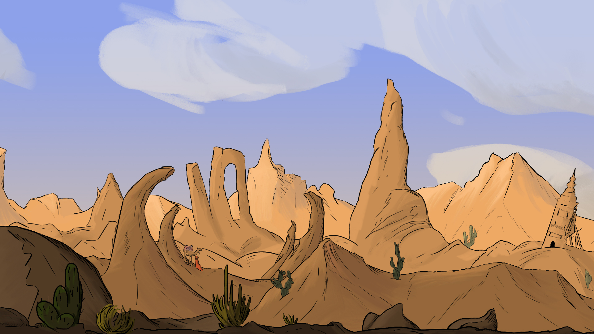

<header class="hero">
  <h1>Dedal des couleurs</h1>
  
Un petit sous-titre

</header>

.hero {
  background-image: url("GUIMBAULT_Noham.jpg");
  background-size: cover;
  background-position: center;
  height: 400px;

  display: flex;
  flex-direction: column;
  justify-content: center;
  align-items: center;

  color: white;
  text-align: center;
}

 
  

    <h1 style="margin: 0; font-size: 2.5rem; text-shadow: 2px 2px 4px rgba(0,0,0,0.6);">Dedal des couleurs</h1>
  

  return (
      </h1>
    

  return (
    <main className="bg-[#f5f1ea] w-full min-w-[1280px] min-h-[4476px] relative overflow-hidden">
      <section aria-label="Présentation de la galerie">
        <Image
          className="absolute top-0 left-0 w-[1280px] h-[741px] aspect-[1.78] object-cover"
          alt="Noham Guimbault"
          src={GUIMBAULTNoham1}
        />
        <Image
          className="top-[47px] absolute left-[827px] w-[419px] h-[324px] aspect-[1.33] object-cover"
          alt="Lineup de personnages"
          src={lineupCharaSecondaire1}
        />
        <Image
          className="top-[218px] left-[609px] w-[354px] h-[205px] object-cover absolute aspect-[1.78]"
          alt="Décor de scène"
          src={SCENe03Background1}
        />
        <Image
          className="absolute top-[338px] left-[526px] w-[540px] h-[314px] aspect-[1.78]"
          alt="Illustration d'animation"
          src={illustration1BarretTristanGuimbaultNoham1}
        />
        <h1 className="absolute top-[267px] left-[89px] w-[439px] [font-family:'Instrument_Serif-Regular',Helvetica] font-normal text-black text-5xl tracking-[0] leading-[normal]">
          L&apos;Animation par Noham Guimbault
        </h1>
        <a
          href="#artistes"
          className="absolute top-[423px] left-[109px] w-[201px] h-[63px] flex items-center justify-center bg-color-background-warning-secondary-hover rounded-[45px] border border-solid border-colors-accents-orange [font-family:'Instrument_Serif-Regular',Helvetica] font-normal text-[#ff8d28] text-[32px]"
        >
          En savoir +
        </a>
      </section>
      <section aria-label="Présentation de Dedal des couleurs">
        <Image
          className="top-0 left-0 w-[1280px] h-[741px] aspect-[1.78] absolute object-cover"
          alt="Noham Guimbault"
          src={GUIMBAULTNoham2}
        />
        <h2 className="top-[67px] left-[66px] w-[413px] [font-family:'Playfair_Display-Regular',Helvetica] text-5xl absolute font-normal text-[#21152e] text-center">
          Dedal des couleurs
        </h2>
        

          Dedal des couleurs, l&apos;animation comme œuvre d&apos;art
           
           
          Au cœur de Paris, au 10 rue de la République, Dedal des couleurs ouvre
          ses portes à un art encore trop peu exposé : l&apos;animation. Fondée
          par Paul Dechewsky, passionné d&apos;art depuis plus de trente ans, la
          galerie présente le travail de Noham Guimbault, qui donne vie à ses
          dessins. Illustrations, images clés, planches et extraits de films :
          chaque œuvre dévoile les coulisses d&apos;une histoire en mouvement.
           
           
          Que vous soyez collectionneur, curieux, étudiant ou professionnel,
          Dedal des couleurs vous invite à découvrir, acquérir et partager un
          art qui prend vie.
        

        <Image
          className="top-[77px] absolute left-[827px] w-[419px] h-[324px] aspect-[1.33] object-cover"
          alt="Lineup de personnages"
          src={lineupCharaSecondaire2}
        />
        <Image
          className="top-[277px] left-[588px] w-[418px] h-[241px] absolute aspect-[1.78]"
          alt="Décor de scène"
          src={SCENe03Background2}
        />
        <Image
          className="absolute top-[485px] left-[673px] w-[540px] h-[314px] aspect-[1.78]"
          alt="Illustration d'animation"
          src={illustration1BarretTristanGuimbaultNoham2}
        />
        <a
          href="#artistes"
          className="absolute top-[375px] left-[52px] w-[201px] h-[63px] flex items-center justify-center bg-color-background-warning-secondary-hover rounded-[45px] border border-solid border-colors-accents-orange [font-family:'Instrument_Serif-Regular',Helvetica] font-normal text-[#ff8d28] text-[32px]"
        >
          En savoir +
        </a>
        <h2 className="absolute top-[250px] left-[66px] w-[439px] [font-family:'Playfair_Display-Regular',Helvetica] font-normal text-[#21152e] text-[40px]">
          L&apos;Animation par Noham Guimbault
        </h2>
      </section>
      <blockquote className="absolute top-[882px] left-[287px] [font-family:'Playfair_Display-Regular',Helvetica] font-normal text-[#21152e] text-5xl text-center">
        &quot;L&apos;art prend vie, l&apos;émotion reste&quot;
         
        M.Dehewsky
      </blockquote>
      <section
        id="artistes"
        className="absolute top-[1435px] left-0 w-[1280px] h-[756px]"
        aria-label="Nos artistes"
      >
        <Image
          className="top-0 left-8 w-[828px] h-[621px] aspect-[1.33] absolute object-cover"
          alt="Études de maîtres de Noham Guimbault"
          src={artworkSlides[1]}
        />
        <Image
          className="absolute top-0 left-[875px] w-[405px] h-[621px] aspect-[0.85]"
          alt="Silhouettes de Noham Guimbault"
          src={silhouetteSlides[1]}
        />
        {carouselDots("650px", "604px")}
      </section>
      <section
        className="absolute top-[2202px] left-0 w-[1280px] h-[756px] bg-[#d8d2cb]"
        aria-label="Biographie"
      >
        <h2 className="absolute top-[74px] left-[68px] w-[251px] [font-family:'Playfair_Display-Regular',Helvetica] font-normal text-[#21152e] text-[32px]">
          Nos Artistes
        </h2>
        

          Noham Guimbault, l&apos;art de faire vivre les images
           
           
          Formé à l&apos;animation, Noham Guimbault imagine, crée et anime ses
          propres idées. Ses personnages, aux couleurs vives et aux traits
          expressifs, donnent vie à des sujets qui l&apos;inspirent et le
          touchent.
           
           
          Nourri par le cinéma d&apos;animation, il raconte des histoires
          simples qui touchent par leur sincérité.
           
           À travers l&apos;animation, Noham cherche à transmettre des
          messages. Vous pourrez le découvrir notamment avec son projet
          collaboratif Red Pill.
           
           
          La galerie présente aujourd&apos;hui une sélection de ses images clés,
          de ses planches de recherche et de ses projets en cours.
        

        <Image
          className="absolute top-[59px] left-[640px] w-[409px] h-[227px] aspect-[1.8] object-cover"
          alt="Capture d'écran d'animation"
          src={captureDECran20261022A1625491}
        />
        <Image
          className="absolute top-[258px] left-[865px] w-[334px] h-[249px] aspect-[1.36] object-cover"
          alt="Capture d'écran d'animation"
          src={captureDECran20261022A1631242}
        />
        <Image
          className="absolute top-[461px] left-[638px] w-[464px] h-64 aspect-[1.84] object-cover"
          alt="Capture d'écran d'animation"
          src={captureDECran20261022A1630151}
        />
        <button
          type="button"
          className="absolute top-[584px] left-20 w-40 h-[34px] bg-[#ffe8a3] rounded-[45px] border border-solid border-[#ff8d28] [font-family:'Montserrat-Regular',Helvetica] text-[#ff8d28] text-lg"
        >
          + d&apos;infos
        </button>
      </section>
      <section
        className="absolute top-[3036px] left-0 w-[1280px] h-[350px]"
        aria-label="Intentions de la galerie"
      >
        <h2 className="absolute top-0 left-[345px] [font-family:'Playfair_Display-Regular',Helvetica] font-normal text-[#21152e] text-[32px]">
          Les intentions de Dedal des couleurs
        </h2>
        <Image
          className="absolute top-[98px] left-[139px] w-[188px] h-[213px] aspect-[0.88]"
          alt="Illustration décorative"
          src={sansTitre22Octobre2026A15371831}
        />
        <Image
          className="absolute top-[68px] left-[569px] w-[145px] h-[253px] aspect-[0.58]"
          alt="Illustration décorative"
          src={sansTitre22Octobre2026A15371841}
        />
        <Image
          className="absolute top-[98px] left-[972px] w-[150px] h-[191px] aspect-[0.79]"
          alt="Illustration décorative"
          src={sansTitre22Octobre2026A15371851}
        />
        

          Collectionner des oeuvres d&apos;art
        

        

          Exposer de jeunes artistes
        

        

          Proposer un accès à l&apos;Art pour tous
        

      </section>
      <section
        className="absolute top-[3478px] left-0 w-[1280px] h-[420px]"
        aria-label="Ateliers et événements"
      >
        <h2 className="absolute top-0 left-[63px] [font-family:'Playfair_Display-Regular',Helvetica] text-[#21152e] text-[40px]">
          Nos ateliers / événements
        </h2>
        <Image
          className="absolute top-[82px] left-[53px] w-[374px] h-[282px] aspect-[1.34] object-cover"
          alt="Atelier dessins"
          src={captureDECran20261022A16312411}
        />
        <Image
          className="absolute top-[82px] left-[449px] w-[382px] h-[285px] aspect-[1.33] object-cover"
          alt="Vidéo d'animation"
          src={image1}
        />
        <Image
          className="absolute top-[81px] left-[849px] w-[375px] h-[283px] aspect-[1.33] object-cover"
          alt="Storyboard de scène"
          src={storyboardSceNe0311}
        />
        

        <Image
          className="absolute top-[256px] left-[63px] w-[364px] h-[57px]"
          alt="Décoration"
          src={rectangle13}
        />
        

        <Image
          className="absolute top-[267px] left-[461px] w-[371px] h-[89px]"
          alt="Décoration"
          src={rectangle20}
        />
        

        

        <button
          type="button"
          aria-label="Lire la vidéo"
          className="absolute top-[202px] left-[604px] w-[60px] h-[60px] bg-white rounded-[30px] border-[0.5px] border-solid border-black flex items-center justify-center"
        >
          <Image className="w-[25px] h-[29px]" alt="" src={polygon1} />
        </button>
        

          Atelier dessins
        

        

          Visionnage vidéos
        

        

          Atelier storytelling
        

        

          Venez apprendre les bases de l&apos;animation !
        

        

          Venez regarder nos animations !
        

        

          Venez créer votre histoire&nbsp;&nbsp;!
        

        <strong className="absolute top-[326px] left-[82px] [font-family:'Montserrat-Bold',Helvetica] text-[#21152e] text-base leading-10">
          20 membres
        </strong>
        <strong className="absolute top-[326px] left-[478px] [font-family:'Montserrat-Bold',Helvetica] text-[#21152e] text-base leading-10">
          40 membres
        </strong>
        <strong className="absolute top-[326px] left-[884px] [font-family:'Montserrat-Bold',Helvetica] text-[#21152e] text-base leading-10">
          20 membres
        </strong>
        
          10h-12h
        
        
          14h-16h
        
        
          9h-12h
        
        {carouselDots("391px", "575px")}
      </section>
      <section
        className="absolute top-[3976px] left-0 w-[1280px] h-[500px] bg-[#d8d2cb]"
        aria-label="Contact et newsletter"
      >
        <form
          onSubmit={handleNewsletterSubmit}
          className="absolute top-[-25px] left-[344px] w-[546px] h-[74px] bg-[#f9cb95] rounded-[45px] flex items-center justify-center"
        >
          <label htmlFor="newsletter-email" className="sr-only">
            Adresse e-mail
          </label>
          <input
            id="newsletter-email"
            type="email"
            value={newsletterEmail}
            onChange={(event) => setNewsletterEmail(event.target.value)}
            placeholder="Votre adresse e-mail"
            className="w-[250px] h-10 px-4 rounded-full bg-white text-[#21152e] text-sm"
          />
          <button
            type="submit"
            className="ml-2 px-4 py-2 rounded-full bg-[#ff8d28] text-white text-sm"
          >
            S&apos;abonner
          </button>
        </form>
        

          Abonnez-vous à notre newsletter
        

        {newsletterMessage && (
          

            {newsletterMessage}
          

        )}
        <h2 className="absolute top-[87px] left-20 [font-family:'Montserrat-Bold',Helvetica] font-bold text-[#21152e] text-2xl">
          Prenez rendez-vous avec l&apos;Art
        </h2>
        <address className="absolute top-[83px] left-[765px] not-italic [font-family:'Montserrat-Regular',Helvetica] text-[#21152e] text-xl leading-10">
          01.45.62.34.56
           
          dedal_des_couleurs@gmail.com
           
          10 rue de la république 75000 Paris
        </address>
        

          Rejoignez nous et suivez l&apos;Art
        

        

          dedal_des_couleurs
        

        <Image
          className="absolute top-[107px] left-[707px] w-[50px] h-[120px] aspect-[0.42]"
          alt="Illustration décorative"
          src={sansTitre22Octobre2026A15371821}
        />
        <Image
          className="absolute top-[229px] left-[688px] w-[191px] h-[75px] aspect-[2.54]"
          alt="Logo de la galerie"
          src={sansTitre22Octobre2026A1537181}
        />
        <Image
          className="absolute top-[371px] left-0 w-[1280px] h-px"
          alt=""
          src={line2}
        />
        <nav
          className="absolute top-[408px] left-[199px] [font-family:'Montserrat-Regular',Helvetica] text-[#21152e] text-xl"
          aria-label="Liens légaux"
        >
          <a href="#terms">Termes</a>
          
            <a href="#privacy">Politique de Confidentialité</a>
          
          <a href="#cookies">Cookies</a>
        </nav>
      </section>
      <Image
        className="absolute top-[11px] left-[1219px] w-[61px] h-[137px] aspect-[0.56] object-cover"
        alt="Illustration décorative"
        src={sansTitre22Octobre2026A15371811}
      />
    </main>

